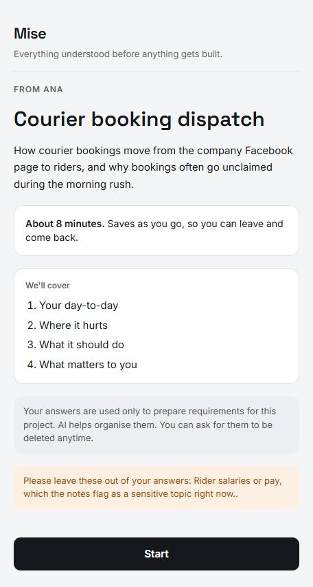
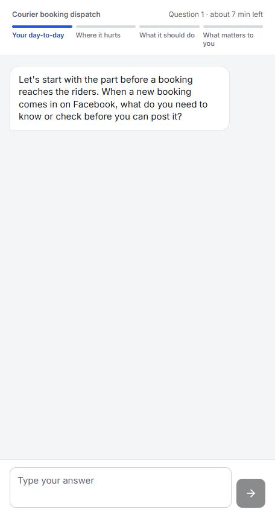
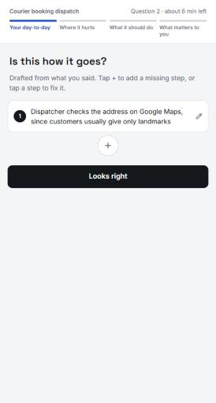
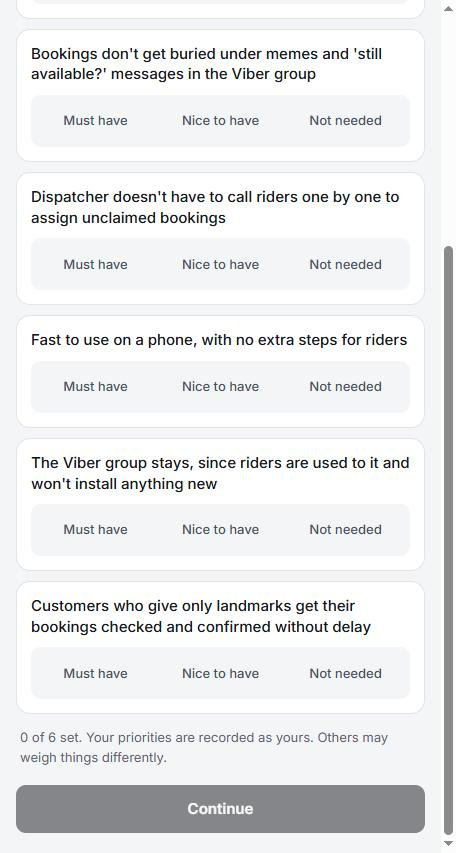
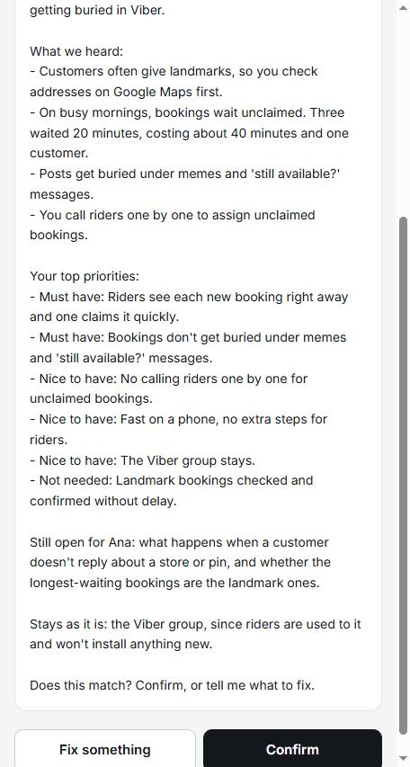

# Mise

**Send one link. They answer in their own time. You get a clear brief back, no meeting needed.**

Mise is an asynchronous requirements-elicitation tool. Instead of booking a
discovery call, you send a colleague, client or prospect a link. An AI
interviewer walks them through a short, structured conversation on their phone,
and when they confirm their answers, both of you get a formatted document: an
Elicitation Session Summary or a Pre-Audit Brief.

**Live app:** https://mise.emmnlsttn1.workers.dev

| Welcome | Conversation | Step cards | Priorities | Landing |
| --- | --- | --- | --- | --- |
|  |  |  |  |  |

## How it works

1. **The sender sets up a link.** They paste rough notes; the AI drafts the
   topic, what's already known, assumptions to confirm, a process sketch and
   off-limits topics. Everything is editable before the link is created.
2. **The respondent answers, no account needed.** A few quick taps, then a
   conversation of about ten questions that follows a visible topic map. They
   correct the process as step cards, pause at a checkpoint, and rank what
   matters ("Must have", "Nice to have", "Not needed").
3. **They confirm, and the document is written.** A summary is played back for
   confirmation; on Confirm, a stronger model writes the document from the
   confirmed answers only, citing the question each finding came from.
4. **Both sides keep a copy.** The sender sees it in their links (signed in with
   Google, on any device); the respondent can save it as PDF or Markdown. The
   respondent can delete their answers at any time; everything expires after 90 days.

Two templates ship: **Requirements session** (go deep on one process) and
**Pre-audit intake** (sweep a small business before a consulting call).

## Engineering highlights

- **The app, not the model, controls the interview.** Question counting, the
  move to priorities and the ending are enforced in code; the model can only
  return the kinds of turn the current step allows, and it can never end a
  session on its own. See [ADR-002](docs/decisions/ADR-002-app-controlled-interview-flow.md).
- **Model choice by evals, not vibes.** 14 scripted respondent scenarios
  (off-limits topics, contradictions, Taglish, "just tell me what to build")
  were run against four models; Claude Haiku 5.5 passed with no failures at
  about 1/25 the cost of Sonnet. See [the scorecard](prompt-evals/results/SUMMARY.md).
- **Spend can't run away.** Each AI call is reserved in the database before
  it is made (optimistic locking), so parallel tabs or scripts can't exceed a
  session's call cap; creation is limited per account and per IP; the AI
  gateway has a hard monthly spend limit.
- **Privacy by default.** IPs are stored only as salted hashes, the AI gateway
  keeps no logs, share links use 144-bit tokens, and the respondent's copy of a
  Pre-Audit Brief leaves out the consultant's call prep.
- **Security.** Google sign-in with PKCE and state checks, hashed login tokens
  in httpOnly cookies, same-site redirect validation, an Origin check on API
  writes, and a strict Content-Security-Policy. See
  [ADR-003](docs/decisions/ADR-003-google-sign-in-and-respondent-copy.md).

## Stack

- **Cloudflare Workers** with **Hono** (API), **D1** (SQLite) and a Cron Trigger
  for the 90-day cleanup; static assets served by the same Worker.
- **Claude through Cloudflare AI Gateway**: Haiku 5.5 interviews and drafts the
  setup, Opus 5.5 writes the final document. See
  [ADR-001](docs/decisions/ADR-001-cloudflare-and-open-models.md).
- **React 19, TypeScript, Tailwind CSS v4, Vite**, mobile-first.
- **Vitest** for the flow, locking, redirect and document-copy rules.

## Run it locally

Requires Node.js 20+ and a Cloudflare account (the AI binding always calls
Cloudflare, so local runs use your AI Gateway).

```bash
npm install
npm run db:migrate          # local D1 schema
echo DEV_LOGIN=1 > .dev.vars  # sign in locally without Google
npm run dev                 # http://localhost:5173
```

Other commands: `npm test`, `npm run typecheck`, `npm run build`. Prompt evals:
`npm run build`, then `npm run dev:eval` and `npm run eval -- --model <id>`.

## Deploy

```bash
npx wrangler d1 migrations apply mise --remote
npm run build && npx wrangler deploy
```

Secrets (set with `wrangler secret put` or in the Cloudflare dashboard):
`IP_HASH_SALT`, `GOOGLE_CLIENT_SECRET`. `GOOGLE_CLIENT_ID` and the model names
are plain variables in `wrangler.jsonc`.

## Project layout

```
src/server/     Worker API: routes, sign-in, turn loop, setup drafter, synthesis, prompts
src/client/     React app: setup, respondent flow (R1-R8), owner pages
src/shared/     API contract and templates, shared by both sides
migrations/     D1 schema
prompt-evals/   Interviewer eval scenarios, runner and results
docs/           Project state, decisions (ADRs), services, screenshots
source/handoff/ The original product brief, flows and requirements
```

## How it was built

Mise was built with an AI coding agent working under
[Engineering OS](docs/os/ARCHITECTURE.md), a repository-native contract for
planning, implementing and independently reviewing changes. `AGENTS.md`,
`skills/` and `docs/os/` belong to that workflow, not to the app.
